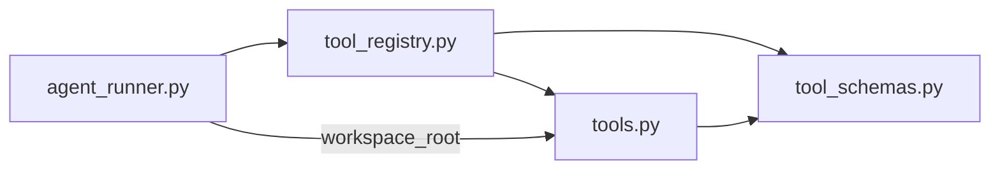

# 第5章应用：统一工具注册

> 2026-10-23。六项工具登记、三个生成结构、旧登记移除、runner导入及顺序执行策略均已静态通过，本节完成。原安排的Python专用搜索工具练习已撤下，原因见[方案说明](Agent第08章_跨Python文件搜索.md)。

## 1. 这次解决什么问题

当前tool_schemas.py手动维护tool_arg_models、六份AgentTool说明及tool_specs，tools.py另有tool_functions。新增工具时，需要把同一个工具分别加到多个名单。

本次用一个tool_registry字典集中登记工具名称、参数类、执行函数和说明，再从它生成现有三种结构。参数类定义在tool_schemas.py，函数实现在tools.py，注册模块把两者关联起来。

## 2. 一条登记是什么样

以read_file为例，资料格式如下；实际字典应登记现有六个工具：

```python
tool_registry = {
    "read_file": {
        "args_model": ReadFileArgs,
        "function": read_file,
        "description": "读取workspace/下的文件，行号从1开始，包含起始行和结束行",
    },
}
```

ReadFileArgs从tool_schemas导入，read_file从tools导入。这里保存类与函数本身，所以不加括号；原有参数校验和执行环节之后再使用它们。

## 3. 从一份登记生成什么

使用普通for遍历tool_registry.items()即可，不要求字典推导式。遍历得到的名称来自外层键，资料来自对应的小字典。

| 生成变量 | 结构及内容 |
| --- | --- |
| tool_arg_models | 字典：工具名称对应资料中的args_model |
| tool_functions | 字典：工具名称对应资料中的function |
| tool_specs | 列表：每条资料生成一个AgentTool对象 |

构造AgentTool时，name取外层名称，description取资料中的说明，parameters调用该条args_model的model_json_schema()得到。先创建两个空字典和一个空列表，再在循环中逐项填入即可。

### 取值、写入字典与追加列表

学员问“是用get生成吗”：get负责从已有字典取值，生成目标字典需要用目标字典[键] = 值写入。此前只给结构表，省略了这一步操作，需要补清楚。

用不同资料作例子：

```python
products = {"apple": {"price": 5}, "pear": {"price": 8}}
prices = {}
for name, info in products.items():
    prices[name] = info["price"]
# prices现在是{"apple": 5, "pear": 8}
```

第一次循环name是apple，info是对应的price小字典；右侧取出5，左侧将apple作为键写入prices。对应工具资料，name是工具名称，info是包含args_model、function、description的小字典。固定字段可以直接用info["args_model"]取出参数类；取出之后还要赋给目标字典的对应键。

tool_functions同样按名称写入资料中的function。tool_specs需要保存多个AgentTool对象，是列表，应初始化为[]；列表追加一个对象用append。构造对象时三个字段的具体来源为：

| AgentTool字段 | 值的来源 |
| --- | --- |
| name | 当前循环的name |
| description | info["description"] |
| parameters | info["args_model"].model_json_schema() |

首版草稿已正确登记六个工具，循环体尚空，tool_specs误初始化为{}且缺AgentTool导入。补讲后，学员已修正为列表、补导入，并写出两个字典赋值及AgentTool构造/append；这部分静态通过。

## 4. 注册迁移（已静态通过）

1. 新建D:/code/dsh/python-course/code/agent_v1/tool_registry.py，导入AgentTool、六个参数类和六个工具函数；登记现有六个工具，并按第3节生成三个变量。说明文字沿用原定义。
2. tool_schemas.py保留AgentTool及六个参数类，移除原六份工具说明对象、tool_arg_models和tool_specs；tools.py移除原tool_functions字典。
3. agent_runner.py改从tool_registry导入tool_arg_models、tool_specs和tool_functions；workspace_root仍从tools导入。现有三种变量的形状匹配原调用点。

这些修改构成同一项完整任务：登记资料集中到新模块，原调用处改用生成的资料。已有调用点已搜索核对，当前只有agent_runner导入原三份登记结构。

最新回读：tool_schemas只保留AgentTool及参数类，tools原函数字典已移除，runner从tool_registry导入三生成变量并单独从tools导入workspace_root，迁移静态通过。

## 5. 导入方向



注册模块需要同时知道参数类和工具函数，因此放在独立模块中装配；tool_schemas和tools提供定义，runner使用装配结果。这样各层的来源清楚，也避免在参数模块中反向导入工具实现而形成循环导入。

本项由学员亲写；源码静态正确即继续，当前不新增测试脚本、故障场景或模型请求。工具批次的现有顺序/并发策略属于独立调度逻辑，本次登记整理按当前策略接入。

## 6. 登记顺序执行策略

execute_tool_batch当前通过逐个比较write_file、edit_file、run_python三个函数，判断整批是否顺序执行。将这项策略也登记到工具资料中，之后调度函数按登记查找。

每个工具资料增加requires_serial布尔字段，表示这类工具出现时需要整批顺序执行：

| 工具 | requires_serial |
| --- | --- |
| read_file、list_files、search_file | False |
| write_file、edit_file、run_python | True |

这是Python本地的执行策略，不放进提供给模型的参数schema。

本次一起完成三处：

1. 在tool_registry.py的六条资料中补齐requires_serial；新增空列表serial_tool_functions。
2. 在已有生成循环中，资料的requires_serial为True时，将该资料的function追加到serial_tool_functions。列表保存函数对象，和tool_functions字典保存的值相同。
3. agent_runner导入serial_tool_functions。在execute_tool_batch原有for循环中，把逐个函数比较的条件改为item[2] in serial_tool_functions；条件成立时设置现有分支标志，走整批顺序执行，否则走gather分支。

item[2]来自valid_tools的四项元组，其中第三项是已经校验过的工具函数，所以与列表中的函数对象匹配。这里使用列表成员判断即可，不需添加新的函数名称比较或改工具参数。

本项仍由学员亲写，静态正确即继续，不另加调度验证脚本或运行门槛。

首版回读：六项requires_serial取值、runner导入和item[2]成员判断均正确；列表追加时误写serial_tool_functions.append(info["requires_serial"])，形成三个True。requires_serial用于筛选是否收录，function才是应收录并参与匹配的值。

最新回读：追加值已改为info["function"]，与item[2]的函数对象匹配，策略登记静态通过，本节完成。不为演示注册方式再增加重复工具；现有工具可以组合完成定位和按行读取。教员未代改源码或运行验证。
