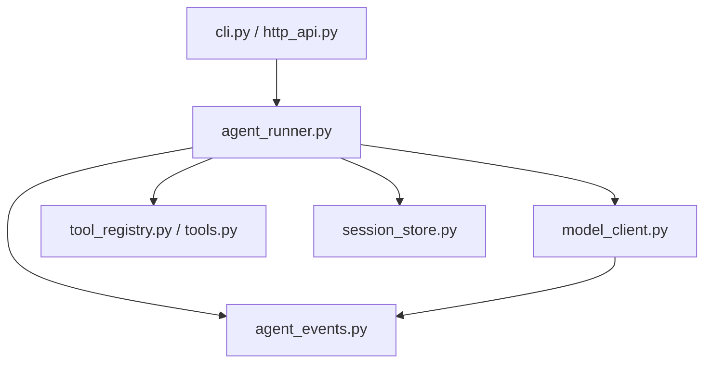

# 进阶第3节：模型调用模块与依赖方向

> 2026-10-27。本节模型模块迁移已整体静态通过：四个函数、请求依赖及常量归属正确，runner和两个mock的导入均已接通。源码由学员亲写，本次未新增运行或测试。完成结果见第7节。

## 1. 这一节解决什么问题

整理前，agent_runner.py既维护上下文、调度工具、控制循环，也包含三类模型请求：流式聊天、非流式聊天和历史摘要。只想使用模型请求函数的现有mock练习，也要先导入runner及其工具、会话等依赖。

本节将模型网络调用与解析归到一个模块，给调用方提供已有的函数接口。请求模块可独立调用，循环仍根据返回消息和完成标志决定是否执行工具、保存历史及进入下一轮。

| 模块 | 本节整理后的职责 |
| --- | --- |
| model_client.py | 请求模型、解析响应、合并流式分片、产生模型输出事件、生成摘要 |
| agent_runner.py | 系统提示、请求视图和预算、摘要缓存、工具校验/执行、循环及会话保存 |

http_client.py是本机/chat服务的客户端；model_client.py是访问DeepSeek模型接口的模块。两个文件服务于不同的调用位置。

## 2. 新模块迁入什么

创建code/agent_v1/model_client.py，将以下四个函数的完整定义迁入，并从runner中移除原定义：

| 函数 | 现有调用与返回约定 |
| --- | --- |
| extract_message | 解析非流式响应，返回消息字典；由下方请求函数内部调用 |
| non_stream_message | 接收client、messages、tools，返回消息或None |
| stream_message | 接收client、messages、tools，返回(message, completed) |
| summarize_messages | 接收client、待摘要消息，返回摘要字符串或None |

迁移时保留现有参数、返回约定、事件、错误及取消处理。摘要提示和其请求构造随summarize_messages一起移动；拆历史、决定何时摘要及更新缓存仍由runner处理。

同时将URL、MAX_OUTPUT_TOKENS及load_dotenv调用迁入新模块。当前读取到MAX_OUTPUT_TOKENS为20000；runner从新模块导入这个值，继续计算INPUT_TOKEN_BUDGET。CONTEXT_BUDGET为200000、TOKEN_MARGIN为10000，继续由runner保存并计算预算。

新模块需要以下现有依赖：asyncio、json、os、httpx，dotenv中的load_dotenv，以及agent_events中的emit。按这些依赖在新模块导入，不从runner反向取得它们。

## 3. runner怎样调用新模块

在agent_runner.py从model_client导入：

- stream_message，供run_agent两处请求模型使用。
- summarize_messages，供prepare_request_messages生成摘要使用。
- MAX_OUTPUT_TOKENS，供输入预算计算使用。

runner仍创建并管理现有的httpx.AsyncClient，再通过client参数传给请求函数，所以它仍需要httpx导入。asyncio仍被工具执行使用，json仍被token粗估和工具参数解析使用。

os、dotenv导入及load_dotenv调用已随模型功能迁走，从runner清理这些旧依赖；URL与MAX_OUTPUT_TOKENS只在新模块定义。emit仍被runner的工具事件使用，因此两个模块分别从agent_events导入emit。

示意调用仍然是：

```python
message, completed = await stream_message(client, request_messages, tools)
```

client来自run_agent已有的async with，request_messages来自已有的请求准备函数，tools来自已有的工具说明构造。导入函数后，调用方不需要知道函数体位于哪一个文件。

## 4. 依赖方向与已有练习文件

模块结构如下，model_client与调用方迁移均已静态通过：



model_client不导入agent_runner。否则runner导入model_client时，model_client又返回导入尚未初始化完成的runner，会形成循环依赖。所需常量在请求模块定义，事件分发从已有独立模块导入。

两个现有mock练习也直接引用新的所属模块：test_stream_mock.py将stream_message的导入改为来自model_client；test_summary_mock.py将summarize_messages的导入改为来自model_client。这里仅更新导入来源，已有用例和运行记录沿用，不增加或运行测试。

## 5. 本次动手与完成条件

一次完成这组迁移：新建model_client.py，搬四个函数、两项常量及其依赖；runner改为导入并清理旧定义；两个已有mock文件调整导入来源。

静态审阅函数归属、名称与返回约定、必要导入、预算常量来源及单向依赖，正确后本节完成。源码由学员亲写，教员不代改；本次不配置其他供应商，也不更换现有模型参数，不增加测试脚本或付费请求。

## 6. 首版静态审阅

四个函数、URL、MAX_OUTPUT_TOKENS、dotenv初始化及必要依赖均已迁入model_client；runner旧定义与os/dotenv清理正确，httpx/asyncio/json/emit保留正确；输出预算从同一常量计算，两个mock均已直接导入model_client。

首版仅agent_runner.py第12行将summarize_messages误写为summarizi_messages，新模块实际定义及runner第116行调用均为summarize_messages，该次会在导入runner时抛ImportError。

最新回读：导入名称已修正为summarize_messages，与定义和调用一致；本节整体静态通过。教员未代改源码、运行或测试。

## 7. 本节完成结果

| 部分 | 已实现并静态核对的结果 |
| --- | --- |
| model_client.py | 四个请求/解析函数、URL、输出额度和dotenv初始化，直接依赖agent_events.emit |
| agent_runner.py | 导入流式与摘要函数及输出额度，保留上下文、工具、循环和HTTP客户端生命周期 |
| 预算 | MAX_OUTPUT_TOKENS在模型模块定义为20000，runner导入后计算输入预算 |
| 既有mock | 从model_client直接导入所需函数，已有用例保持原状 |
| 依赖方向 | runner依赖model_client，模型模块没有反向导入runner |

入口调用仍为：CLI或HTTP服务端 → runner组织任务 → model_client调用模型并返回结果 → runner决定后续操作。

本节实现完成，没有待改源码或额外必做项。静态结论与实际运行证据分别记录，本次没有新增运行、测试、模型请求或Git上传。
