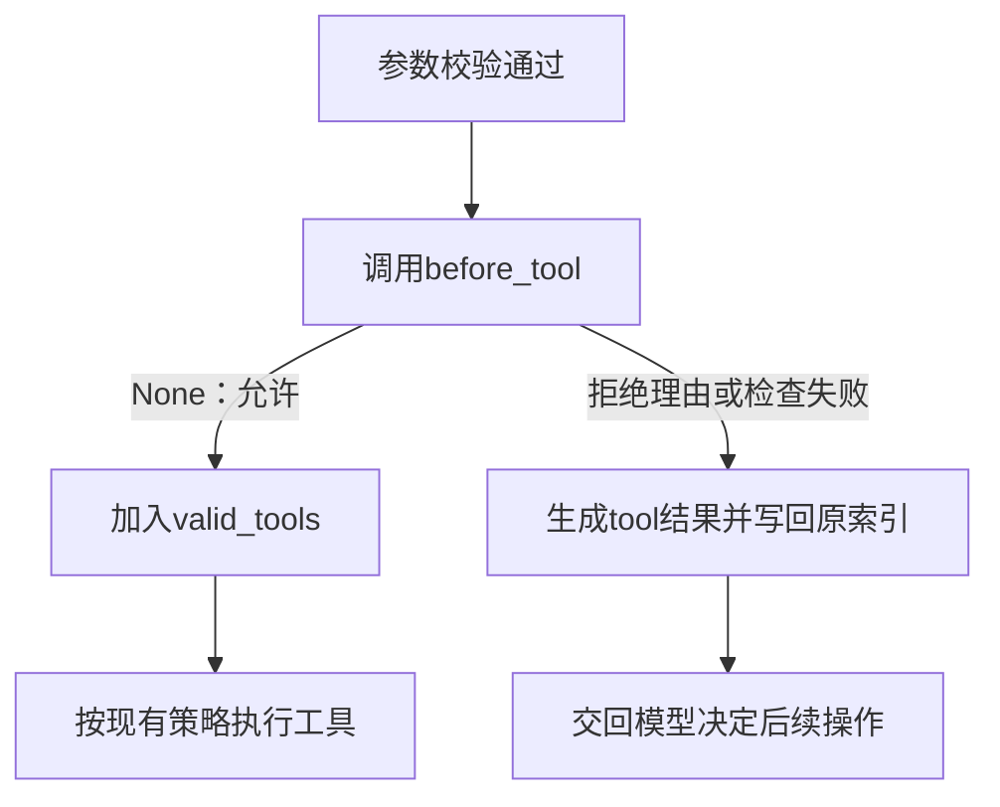

# 进阶第4节：工具决策钩子与只读模式

> 2026-10-29。本节已整体静态通过：只读策略、runner核心机制、CLI/HTTP模式传递以及两个输入循环的命令反馈均已完成。尚未运行本节代码，静态审阅不记为实跑；没有剩余必做项。

## 1. 钩子是什么，和监听器有什么关系

这里的钩子就是：程序执行到指定位置时，先调用调用方提供的函数，再根据函数返回值决定如何继续。

| 接口 | 当前用途 | 返回值如何处理 |
| --- | --- | --- |
| emit里的显示监听器 | 通知工具或模型发生了什么 | emit忽略其返回值，普通显示异常被隔离 |
| 本节before_tool回调 | 决定一个已校验的工具调用能否进入执行列表 | 读取其返回值，拒绝时生成工具结果并跳过执行 |

本次回调只做本地判断，使用普通def。程序在process_tool_call中完成JSON解析、工具查找和Pydantic校验后调用它，传入已有的tool_name和validated_args。

## 2. 回调接口与只读策略

新建code/agent_v1/tool_policies.py，定义普通函数read_only_guard(tool_name, validated_args) -> str | None。

约定如下：

| 返回值 | 含义 |
| --- | --- |
| None | 允许该调用继续执行 |
| 拒绝理由字符串 | 拒绝该调用，将理由作为role=tool结果交回模型 |

本节只读策略明确允许read_file、list_files、search_file；其余工具返回拒绝理由。因此write_file、edit_file和run_python都会被拦截，脚本运行也能写文件。

validated_args是Pydantic校验后的参数对象，本节策略只按名字判断，先保留这个形参；调用接口也能供以后按路径等参数决定的策略使用。

tool_registry里的requires_serial只负责执行顺序。当前只读策略按工具名称明确选择允许范围，调度信息不作为权限结论。

## 3. 核心机制

本段只改新策略模块与agent_runner.py，完成可由Python调用方指定的回调接口。

### 3.1 传入调用方选择的函数

run_agent在现有参数末尾增加before_tool=None；process_tool_call也在现有参数末尾增加before_tool=None。

run_agent调用process_tool_call时，显式传before_tool=before_tool。这个值是一个函数对象，来自run_agent调用方；为None时沿用原来的处理路径。

接口示意如下：

```python
from tool_policies import read_only_guard

await run_agent("只读取文件并说明内容", before_tool=read_only_guard)
```

传入read_only_guard时不加括号，是把函数交给runner；后面真正检查某次工具调用时，才使用tool_name和validated_args调用它。

### 3.2 在进入执行列表之前检查

process_tool_call原有的tool_name来自function_data，validated_args来自argument_model.model_validate。取得这两个已有值后，在valid_tools.append之前加入以下流程：

1. before_tool是None时，继续原有的append。
2. 提供了回调时，调用before_tool(tool_name, validated_args)，用局部变量接收拒绝理由。本次是普通函数调用，不使用await。
3. 返回None时，继续append。
4. 返回字符串时，用make_tool_result生成拒绝结果，写入tool_results[index]，然后return，使这次调用不进入valid_tools。
5. 回调抛普通Exception时，同样写入“工具执行前检查失败”及错误原因的tool结果，然后return，原工具不进入执行列表。

显示监听器的普通错误可以继续通知其他监听器；执行前检查失败则不能被当成允许执行。该处理复用现有工具错误回填机制，不终止整个Agent循环。



拒绝时也必须给原tool_call_id生成结果。只return而不填写结果，会在工具响应列表中留下空项，无法正确回应模型已经提出的调用。

## 4. 两个入口的模式选择

核心机制、模式选择传递链及命令反馈均已静态通过，以下保留实现说明。read_only是布尔值，before_tool是函数对象或None；两者由CLI或服务端进行转换。

### 4.1 两个输入循环使用相同命令

在cli.py与http_client.py的main中，while之前各新增read_only = False。模式由各自入口保存，每次发起任务时传入。

| 命令 | 行为 |
| --- | --- |
| /mode | 显示当前是normal还是readonly |
| /mode readonly | 将read_only设为True并显示切换结果 |
| /mode normal | 将read_only设为False并显示切换结果 |
| /mode后跟其他值 | 显示用法，保留当前选择 |

沿用已有command、argument拆分，在普通任务的else分支之前新增elif command == "/mode"，先对argument做strip再判断。命令只在本地处理；处理完自然回到输入循环。模式与session_id分别保存。创建任务时传入当时的read_only布尔值，之后切换影响下一次任务。

### 4.2 cli.py：把布尔值转换为检查函数

导入from tool_policies import read_only_guard。run_cli_task新增第三个形参read_only=False；main创建任务时，第三个实参传入当前read_only。

在run_cli_task调用run_agent之前选择：

```python
before_tool = None
if read_only:
    before_tool = read_only_guard

await run_agent(
    prompt,
    session_id=session_id,
    before_tool=before_tool,
)
```

read_only_guard不加括号，是把函数交给runner，工具检查阶段才会实际调用它。调用链为main → run_cli_task(prompt, session_id, read_only) → run_agent(..., before_tool=before_tool)。

### 4.3 http_client.py：把布尔值放进请求正文

这个客户端只发送选择，保持通过HTTP调用服务端。需同步修改三处调用层：

1. request_agent在现有参数末尾追加read_only: bool = False，request_body新增"read_only": read_only。
2. run_request新增第三个形参read_only=False，调用request_agent时增加read_only=read_only。
3. main创建run_request任务时，第三个实参传入当前read_only。

请求正文示例：

```python
request_body = {
    "prompt": prompt,
    "session_id": session_id,
    "read_only": read_only,
}
```

HTTPX现有json=request_body会把Python的True/False编码为JSON的true/false。回调函数不放入JSON，客户端也不需要导入tool_policies。

### 4.4 http_api.py：接收选择并交给runner

服务端导入read_only_guard，完成以下调用链：

1. ChatRequest新增read_only: bool = False，省略该字段的原有请求仍为普通模式。
2. chat取出data.read_only，创建run_agent_to_queue任务时用read_only=data.read_only传入；原prompt、queue与session_id继续传递。
3. run_agent_to_queue在现有参数末尾新增read_only: bool = False。在调用run_agent之前，使用4.2的if选择before_tool，再将before_tool=before_tool传给run_agent。

HTTP链路为main → run_request → request_agent → JSON正文 → ChatRequest → chat → run_agent_to_queue → run_agent。布尔值沿链路传递，到服务端才转换为函数对象。

runner已能接收任意符合约定的before_tool，不必知道具体的read_only_guard；可移除runner中未使用的该函数导入。整个选择保存在本次调用的局部参数中，不增加服务端全局模式或监听器登记。

## 5. 完成范围

本节的只读模式限制Agent循环能分发哪些工具；工具函数本身仍是普通Python函数。模型返回的工具名即使存在，也必须通过本次回调检查才能进入执行列表。

已静态审阅策略返回约定、回调传递、检查位置、拒绝/失败回填、允许分支以及两个入口模式选择，本节完成。不增加测试脚本、故障注入或模型请求作为门槛。已有取消、调度、模型模块等章节不重复验收。

2026-10-29核心审阅结果：read_only_guard的名称和三个允许项已修正，before_tool默认None的分支已补齐，run_agent到process_tool_call传参正确，拒绝及普通异常均回填原tool结果；核心部分静态通过。

2026-10-29入口审阅结果：CLI创建后台任务并逐层传递read_only，助手选择检查函数；HTTP客户端正文含read_only、服务端请求模型接收该字段并通过chat和run_agent_to_queue传给runner，当前任务使用传入的局部选择。runner的未使用策略导入已移除。以上链路静态正确；run_cli_task的read_only无默认值，但现有调用均显式传入，不要求为形式增加默认值。仅剩两个输入循环的/mode无参时显示布尔值、未知参数时静默：需按4.1改为模式名称及用法提示。当前不新增其他源码修改、测试或模型请求要求。

2026-10-29最终审阅：两个入口的/mode均已显示“只读模式”或“标准模式”，未知参数也显示两个有效命令，符合本节要求。“标准模式”与本讲义“普通模式”均对应normal，不要求改词。连同已通过的策略和参数链，进阶第4节整体完成，当前没有待改源码或额外必做项。教员仅静态审阅及更新文档，未代写或运行学生源码、未请求模型或推送GitHub。
