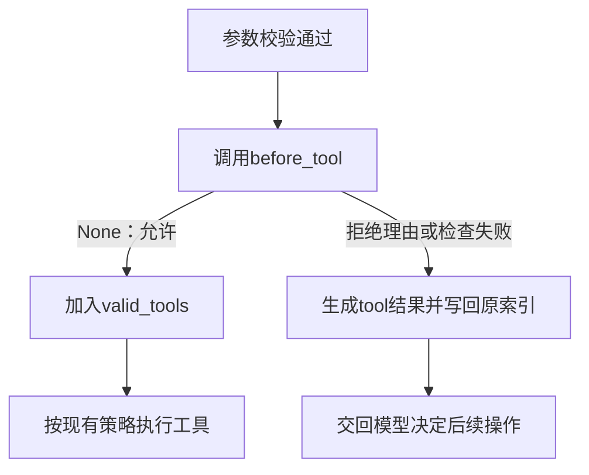

# 进阶第4节：工具决策钩子与只读模式

> 2026-10-27。模型调用模块、多会话和主动停止均已静态通过。当前增加工具执行前的决策回调，以只读策略为例。先接核心机制，再接CLI及HTTP两个入口的模式选择，源码由学员亲写，尚未实现。

## 1. 钩子是什么，和监听器有什么关系

这里的钩子就是：程序执行到指定位置时，先调用调用方提供的函数，再根据函数返回值决定如何继续。

| 接口 | 当前用途 | 返回值如何处理 |
| --- | --- | --- |
| emit里的显示监听器 | 通知工具或模型发生了什么 | emit忽略其返回值，普通显示异常被隔离 |
| 本节before_tool回调 | 决定一个已校验的工具调用能否进入执行列表 | 读取其返回值，拒绝时生成工具结果并跳过执行 |

本次回调只做本地判断，使用普通def。程序在process_tool_call中完成JSON解析、工具查找和Pydantic校验后调用它，传入已有的tool_name和validated_args。

## 2. 回调接口与只读策略

新建code/agent_v1/tool_policies.py，定义普通函数read_only_guard(tool_name, validated_args) -> str | None。

约定如下：

| 返回值 | 含义 |
| --- | --- |
| None | 允许该调用继续执行 |
| 拒绝理由字符串 | 拒绝该调用，将理由作为role=tool结果交回模型 |

本节只读策略明确允许read_file、list_files、search_file；其余工具返回拒绝理由。因此write_file、edit_file和run_python都会被拦截，脚本运行也能写文件。

validated_args是Pydantic校验后的参数对象，本节策略只按名字判断，先保留这个形参；调用接口也能供以后按路径等参数决定的策略使用。

tool_registry里的requires_serial只负责执行顺序。当前只读策略按工具名称明确选择允许范围，调度信息不作为权限结论。

## 3. 当前动手：核心机制

本段只改新策略模块与agent_runner.py，完成可由Python调用方指定的回调接口。

### 3.1 传入调用方选择的函数

run_agent在现有参数末尾增加before_tool=None；process_tool_call也在现有参数末尾增加before_tool=None。

run_agent调用process_tool_call时，显式传before_tool=before_tool。这个值是一个函数对象，来自run_agent调用方；为None时沿用原来的处理路径。

接口示意如下：

```python
from tool_policies import read_only_guard

await run_agent("只读取文件并说明内容", before_tool=read_only_guard)
```

传入read_only_guard时不加括号，是把函数交给runner；后面真正检查某次工具调用时，才使用tool_name和validated_args调用它。

### 3.2 在进入执行列表之前检查

process_tool_call原有的tool_name来自function_data，validated_args来自argument_model.model_validate。取得这两个已有值后，在valid_tools.append之前加入以下流程：

1. before_tool是None时，继续原有的append。
2. 提供了回调时，调用before_tool(tool_name, validated_args)，用局部变量接收拒绝理由。本次是普通函数调用，不使用await。
3. 返回None时，继续append。
4. 返回字符串时，用make_tool_result生成拒绝结果，写入tool_results[index]，然后return，使这次调用不进入valid_tools。
5. 回调抛普通Exception时，同样写入“工具执行前检查失败”及错误原因的tool结果，然后return，原工具不进入执行列表。

显示监听器的普通错误可以继续通知其他监听器；执行前检查失败则不能被当成允许执行。该处理复用现有工具错误回填机制，不终止整个Agent循环。



拒绝时也必须给原tool_call_id生成结果。只return而不填写结果，会在工具响应列表中留下空项，无法正确回应模型已经提出的调用。

## 4. 后半段覆盖两个入口

核心机制静态正确后，继续接模式选择，两个入口都覆盖：

- 直接CLI选择普通或只读模式，后台任务将选中的before_tool传给run_agent。
- HTTP客户端发送read_only布尔字段；服务端根据字段选择read_only_guard或None，再传给run_agent。
- 普通模式默认保持None；选择随任务参数传入，当前任务使用创建时收到的策略。

当前先完成第2、3节，不要求提前猜写后半段的参数和命令。整体入口接线会在核心审阅后给完整改动范围，不遗漏CLI或HTTP。

## 5. 完成范围

本节的只读模式限制Agent循环能分发哪些工具；工具函数本身仍是普通Python函数。模型返回的工具名即使存在，也必须通过本次回调检查才能进入执行列表。

先静态审阅策略返回约定、回调传递、检查位置、拒绝/失败回填及允许分支；随后接两个入口模式选择。两段正确后本节完成，不增加测试脚本、故障注入或模型请求作为门槛。已有取消、调度、模型模块等章节不重复验收。
