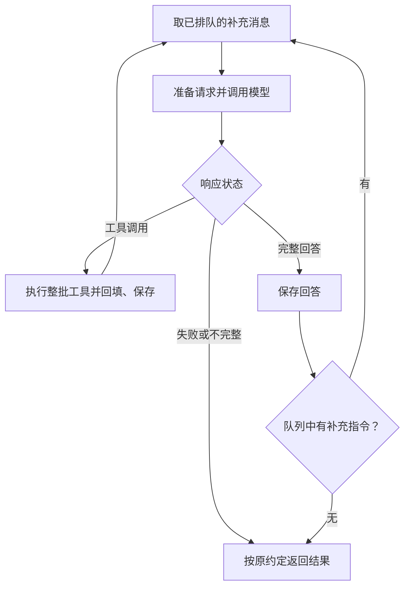

# 进阶第6节：运行中追加指令

> 2026-10-30。本节核心、直接CLI、HTTP服务端及客户端命令链路均已静态通过。补充文字按任务入队，在循环检查点追加为user消息；一次入队确认不限制再次追加。源码由学员亲写，本节尚无新增运行证据，不增加测试或模型请求门槛。

## 1. 目标和生效时机

当前Agent忙碌时，CLI只允许停止或拒绝另一个普通任务。新增命令/steer，允许用户在不重新启动当前Agent任务的情况下补充指令，例如：

```text
审阅 tools.py
/steer 优先检查路径处理，再看其他逻辑
```

这接回[教材第3章](https://www.dgzhuya.com/modules/ch03-agent-loop)中尚未展开的steering：运行中排队的补充消息可以驱动下一次模型调用。后续任务followUp是另一种时机，等当前任务完成后才继续，本段先做一种追加机制。

本项目先采用整批工具收尾后的检查点：已开始的模型响应或工具批次先按原流程完成；当前工具调用与其全部结果写回历史后，下一圈将新指令加入messages，再构造下一次请求。追加指令不取消正在运行的模型请求，也不撤回已执行的操作。需要停止整个任务仍用现有/stop。

若模型已给出完整无工具回答，但检查点发现还有新指令，保存这次回答后继续下一圈，而不是直接返回。模型失败/不完整、输入预算不足或工具轮数上限则沿原规则结束，不由新队列覆盖其失败结果。

## 2. 消息如何从键盘到Agent

```text
CLI读取/steer后面的文字
  → 放入当前任务自己的steering_queue
  → run_agent到达循环检查点
  → 取出文字，构造role=user消息
  → 加入messages、保存并准备请求
  → 下一次模型调用同时看到原任务和补充要求
```

队列里存字符串；messages里存消息字典。队列是任务运行期间的投递通道，消费进messages的消息才进入原来的会话保存流程。每个新任务使用新的队列，不把旧任务的剩余投递交给下一任务。

## 3. 三个队列方法

已学的await queue.get在队列为空时会等待，事件发送循环需要这种等待。本节每个检查点只拿走已经排队的消息，队列为空就继续Agent流程，因此使用：

| 调用 | 含义 |
| --- | --- |
| queue.put_nowait(text) | 立即把一条文字放入队列 |
| queue.empty() | 返回队列是否为空的布尔值 |
| queue.get_nowait() | 立即取出最早的一条；空队列会抛QueueEmpty |

例如下面展示队列自身的输入与输出，不是作业函数的完整实现：

```python
notes = asyncio.Queue()
notes.put_nowait("优先看测试文件")
text = notes.get_nowait()
```

text是刚才放入的字符串，get_nowait已经把它从队列取走。本节用默认无界队列，CLI投递与Agent消费均在同一事件循环；取消息的普通函数内部不await，可以先用empty判断后逐条get_nowait。参考[Python 3.12官方队列文档](https://docs.python.org/3.12/library/asyncio-queue.html)。

## 4. agent_runner.py：队列消费与统一循环

### 4.1 增加消费函数

本小节已静态通过。前次把新队列方法、循环改造和CLI接线同时布置，跨度过大，现已先完成消费函数；下面保留具体输入输出与修正过程，当前推进4.2、4.3，CLI仍在之后接入。

定义普通函数drain_steering_messages(steering_queue)，返回消息列表：

- 参数为None时返回空列表，兼容原有调用方。
- 队列非空时逐条取字符串，每条构造成role=user、content为该字符串的消息，按到达顺序放进列表。
- 队列取空后返回列表。这里不调用模型、不写盘、不发送事件，保存由run_agent负责。

具体例子：用户让Agent审阅文件，随后补充“先检查路径处理”“也看看异常处理”。CLI先将这两条文字放进队列；模型还没有收到它们。消费函数取走文字后，应返回：

```python
[
    {"role": "user", "content": "先检查路径处理"},
    {"role": "user", "content": "也看看异常处理"},
]
```

返回列表随后才由run_agent加入messages，并随下一次模型请求发送。正在生成的那次请求不会因Python队列变化而自动改变。

None表示调用方没有提供队列；一个存在但empty为True的队列表示当前没有待处理文字。这两种情况均返回空列表。原先的None分支应保留，后面需要用一个列表收集所有排队文字：循环中取一条、构造字典、append，循环结束后return列表。

2026-10-30首版中return ["role": "user", "content": text]混淆了列表与字典，会产生语法错误。外层列表保存多条消息，内部每条消息是一个字典；还需覆盖空队列及多条消息，不能只调用一次get_nowait。当前不同时审阅未完成的CLI分支或布置循环重构。

2026-10-30第二次回读：temp=[]、append消息字典及末尾return temp的结构已正确。当前if not steering_queue.empty(): return temp会在有消息时直接返回空列表，且原None入口检查被删；恢复if steering_queue is None时返回空列表。asyncio.Queue不能直接for text in queue遍历，需在非空时用while循环，并在循环内通过get_nowait取出并移除一条文字，再执行现有append。队列为空时循环自然跳过，最后返回空列表；循环后的return位置保留。只修这两处控制流程，不新增运行或验证要求。

2026-10-30最新回读：None返回空列表已恢复，while非空时逐条get_nowait、append消息字典正确，return temp在循环之后。未提供队列、空队列和多条排队文字的控制流程均正确，消费函数静态通过，不追加运行要求。

### 4.2 run_agent增加参数

在run_agent现有参数末尾加steering_queue=None，原有其他参数和三键返回约定沿用。HTTP入口暂未传队列，None分支应维持其正常调用能力。

当前草稿在函数结尾写了steering_queue = None，它只是函数体内赋值，不能接收调用方的队列。移除该行，默认值应写在函数定义的参数列表末尾。

### 4.3 将两处模型请求合为一个循环入口

当前初次prepare/stream在while前，工具执行后的prepare/stream在while末尾。为避免再写第三套请求逻辑，将它们合为async with内部的一个while True：每圈从“取补充消息、准备请求、调用模型”开始。

每圈顺序如下：

1. 用steering_messages接收drain_steering_messages(steering_queue)返回值；有消息时将列表extend进messages并保存会话，再进入请求准备。
2. 调用已有prepare_request_messages，并按已有保存点保存会话。预算失败仍返回当前的Agent失败结果。
3. 调用一次stream_message，取message与completed。message为None时直接返回model_result，不能再依赖旧while条件的自然退出。
4. completed为False时沿用部分消息保存及返回逻辑。
5. 完整无工具回答时，先追加并保存message；队列存在且非空则continue进入下一圈，否则返回model_result。
6. 完整工具调用时，沿用原有轮数判断、参数校验、策略检查、执行、结果回填和保存；批次收尾后自然回到循环顶部。

先前在while前及工具分支末尾的重复prepare/stream片段移除，整个run_agent只保留这一处流式请求调用。原来while后的return model_result由第3步显式的None退出接替，不能在新while True后继续依赖它。

turn_count仍在循环外初始化，只统计原来的工具批次，不因追加指令重置。注入后的user消息仍由原会话及摘要逻辑处理；不重建会话、不修改只读策略、不把队列对象放进messages。

对照当前代码搬动：async with中的首次prepare、保存、预算判断和stream取字段一整段移进新的while True顶部；旧的while message is not None这一行移除，其处理主体接在新请求代码之后。在取到message/completed后先判断message是否为None，为None立即返回model_result，再进入原不完整/最终回答/工具处理分支。旧while末尾重复的prepare/stream整段移除，工具回填保存后自然回到新循环顶部。

完整无工具回答分支保存后，先判断steering_queue非None且非空，是则continue进入循环顶部，否则沿用原return model_result。旧循环之后的return由圈内的None判断接替。while True的退出仍由这些原有结果return控制，不依赖外部强制停止。

2026-10-30回读：队列参数、单一while True顶部请求、None及不完整返回、无工具回答后检查队列、工具批次完整回填后回圈顶及工具计数位置均正确。当前只需将补充消息的保存提前到prepare之前：用steering_messages接住消费函数的列表，有消息时extend并立即save_session，再执行prepare。prepare可能等待摘要，先保存使已经取走的用户指令及时落盘；prepare之后的既有保存仍负责更新后的摘要缓存。这一小处与下面CLI接线合并完成，不另设确认或运行门槛。



## 5. cli.py：给当前任务投递指令

本节已静态通过。队列对象由CLI创建一次，经run_cli_task传到run_agent；消费函数随后读取的就是同一个对象。下面保留实现说明。

### 5.1 保存和传递当前队列

main的while之前增加steering_queue=None。普通输入启动新任务前创建asyncio.Queue，保存到这个变量；run_cli_task新增末尾参数steering_queue=None，main创建任务时把当前队列传给它，助手再传入run_agent的steering_queue参数。

两处调用都显式增加steering_queue=steering_queue：一处是main创建run_cli_task的协程，另一处是run_cli_task等待run_agent。左侧为被调用函数的参数名，右侧为当前函数收到或创建的队列变量。

取消/stop完成后可以随agent_task一起将队列引用设为None。普通新任务总是重新创建队列；不要把创建写进输入循环每次读命令的位置，否则/steer会拿到与正在运行的Agent不同的队列。

### 5.2 新增/steer命令分支

沿用已有partition拆出的command和argument，在普通任务else之前增加/steer分支：

把现有草稿的elif user_prompt == "/steer"改为elif command == "/steer"，否则带文字的/steer命令不会进入该分支。argument是后面的补充文字，先strip后判断。

- argument.strip后为空：显示用法/steer 补充指令。
- 当前没有活跃agent_task，即None或done：说明当前没有运行任务，请直接输入新任务。
- 有活跃任务：steering_queue.put_nowait(argument)，显示“补充指令已排队”。

这个分支只投递，不新建另一个Agent Task，也不等待队列被消费。main与run_agent通过显式参数引用同一个队列。命令针对正在运行的任务，其session_id和只读策略仍是创建该任务时选定的值。

## 6. 两个入口与完成范围

第一段当前修改范围为agent_runner.py和cli.py，模型结果、会话格式、工具执行器和旧mock接口沿用。静态正确后继续HTTP：服务端定位活动任务的队列并接收投递，HTTP客户端再接/steer。HTTP未接入前，不声称两个入口都已具备此能力。

4.1消费函数、runner保存顺序/统一循环及第5节CLI均已静态通过，当前推进第7节HTTP服务端，第8节客户端为之后接入，不将尚未接入的HTTP能力记为完成。

检查队列的创建与传递、普通函数消费、一次统一模型请求、tool调用/结果完整回填后才进入新一圈、完整回答后的队列继续条件，以及全部现有失败/取消出口。保留前五节完成状态，不新增测试脚本、故障注入或模型请求作为门槛。

2026-10-30核心与CLI最终回读：新消息已在prepare前保存；CLI的队列在普通任务的空闲分支创建，main→run_cli_task→run_agent传递同一对象，/steer按command分流，缺参及无活跃任务提示、活跃时put_nowait均正确。run_cli_task的队列参数无默认值但唯一调用方已传入，位置参数对应正确；/stop后虽保留旧队列引用，但活跃任务检查阻止继续投递，新任务重新创建队列，因此不追加形式修改。这一段静态通过，未运行源码或请求模型。

## 7. HTTP服务端投递（静态通过）

当前只改http_api.py，沿用现有单worker及agent_lock串行运行Agent的范围。先按session_id找到该会话当前正在运行的任务队列。HTTP客户端投递在服务端静态正确后再接。

### 7.1 先分清两种队列

| 名称 | 放进去的内容 | 谁写、谁读 |
| --- | --- | --- |
| 原有queue | 事件字典，例如text_delta | listener写入，stream_events读取后发给HTTP客户端 |
| 新steering_queue | 用户补充文字字符串 | POST /steer写入，run_agent经drain_steering_messages读取 |

一次任务同时持有两种队列。HTTP请求只发送会话名及文字，不会把Python队列对象从客户端传到服务端。

### 7.2 请求数据与活动登记表

新增SteerRequest(BaseModel)，字段为text: str和session_id: str = "default"。这是新接口接收的正文，例如：

```json
{"session_id": "default", "text": "优先检查路径处理"}
```

在模块顶层、agent_lock附近创建steering_queues = {}。它是字典，键为会话名，值为该会话当前运行任务的补充Queue。示意为steering_queues["default"]指向当前default任务的队列，只有正在执行的任务登记其中。

该表的用途是让另一个HTTP请求能找到run_agent持有的同一个队列；不是历史存储，条目只在任务运行期间存在。

### 7.3 run_agent_to_queue登记与清理

在现有async with agent_lock内部、等待run_agent之前：

1. 创建本次任务的steering_queue = asyncio.Queue()。
2. 使用steering_queues[session_id] = steering_queue登记。
3. 调用run_agent时增加steering_queue=steering_queue，原参数继续传递。
4. 在原有finally中移除本次登记，可用steering_queues.pop(session_id, None)，即删除该会话键，无条目时返回None。原来的移除listener和放入事件结束标记仍保留。

登记放在锁内，因此等待启动的/chat请求不会覆盖当前任务的登记；finally在完成、错误或取消时清理。原有queue继续负责向客户端发送事件，不改作补充队列。

### 7.4 POST /steer接口

新增@app.post("/steer")及异步处理函数steer(data: SteerRequest)，流程如下：

1. 取data.text.strip()，空文字返回普通字典accepted=False、reason说明补充指令不能为空。
2. 用steering_queues.get(data.session_id)查当前队列；为None则返回accepted=False、reason说明当前会话没有运行任务。
3. 找到队列后，使用put_nowait将文字放入，返回accepted=True、reason=None。

两种返回均含accepted及reason字段，作为普通JSON响应，按业务是否接受来判断。accepted=True只表示进入队列，实际使用仍在Agent下一次检查点。

这个投递接口不要等待agent_lock：该锁正在由长任务持有，若投递也等待它，就要等任务结束后才发送，无法实现运行中追加。接口只查活动表并投递，不启动另一个Agent、不等待原任务结束，也不把文字放进事件队列。

### 7.5 接口设计的依据与约定来源

2026-10-30补讲：学员要求明确教授工程思维，并质疑“拆路由避免阻塞”、accepted来源及模型是否理解。这里需要区分职责、等待依赖和数据接收方，不能仅用“都可以”带过设计推荐。

- 职责：/chat启动一次Agent任务并维持输出事件流；/steer向已有任务提交补充文字并迅速确认接收；状态查询则是另一种操作。当前的/steer是控制命令接口，不是查询队列状态的接口。
- 路由：采用不同路径使请求模型、返回形式和生命周期更清楚，但URL路径并不创造并发能力。复用/chat并按操作分流也能实现，当前代码则默认每个/chat请求创建新任务，必须改分流逻辑才可复用。
- 执行：独立/steer如果也等待长期持有的agent_lock，仍会拖到任务结束；async def内部若直接执行同步阻塞工作，同一worker的事件循环仍会被占住。控制接口能及时响应，依赖短处理路径、不等待运行锁及正确的异步/线程使用，不由路径名自动保证。等待异步锁通常只是该协程等待，并不自动等于整个服务被阻塞。
- 生命周期：原/chat请求内容已发送，之后的补充是另一次HTTP请求；原来的事件流继续负责输出。/steer只确认本次投递，不替代原任务，也不等待模型完成。

accepted和reason均为本项目自行定义的HTTP响应字典字段，由客户端程序读取，既不是FastAPI/模型平台预置字段，也不是让模型猜测的提示词。实际Python形式是return {"accepted": False, "reason": "补充指令不能为空"}；草稿中的return accepted=False不是合法的return表达式，不能把字段约定的简写直接当语法。

accepted=True表示文字已经进入本次任务的内存队列，不表示Agent已经取走、模型已经处理或任务最终成功。reason由服务端根据具体拒绝条件填写；客户端稍后用response.json取得字典并读取这些键。模型只会看到被消费并加入messages的role=user、content=text消息，不会看到accepted响应。

HTTP标准另有202 Accepted状态码，含义是请求已被接受处理但尚未完成；它不要求响应体存在名叫accepted的JSON键，返回这个键也不自动设置202状态。本次继续采用原定的普通JSON业务确认，不因补讲改写状态码协议。

当前按session_id查活动队列，依据是单worker与全局agent_lock串行运行任务的简化范围。若之后支持同一会话多次并发执行，应区分会话标识与一次执行的task_id；多worker还涉及跨进程投递。本节不把两个路由当成完整企业架构，只在已有约束下把执行与控制职责分清。

参考：[FastAPI并发与异步](https://fastapi.tiangolo.com/async/)、[Azure异步请求-应答模式](https://learn.microsoft.com/en-us/azure/architecture/patterns/asynchronous-request-reply)、[RFC 9110的202状态语义](https://www.rfc-editor.org/rfc/rfc9110.html#section-15.3.3)。

### 7.6 服务端首版回读

2026-10-30回读：SteerRequest及POST /steer注册、锁内创建/登记/传入补充队列、finally清理正确；空文字和无活动任务的reason、accepted字段字典结构正确，接口没有等待运行锁。首版投递对象的区别如下：

| 名称 | 类型与含义 |
| --- | --- |
| data.session_id | 字符串，会话名 |
| steering_queues | 字典，会话名对应当前任务Queue |
| steering_queues.get(data.session_id)的结果 | 一个Queue或None，宜命名steering_queue |

首版把get结果赋给session_id，实际类型与名称不符，随后却对整个steering_queues字典调用put_nowait，活跃任务投递会报AttributeError。学员已将局部变量命名为steering_queue，以is None判断没有登记，并对这个单个对象调用put_nowait(text)。三处修改已静态通过，服务端本段完成；未运行请求，不把静态结论记为实测。

## 8. HTTP客户端接入（静态通过）

第7节已静态通过。http_client.py已增加普通POST /steer的请求函数并接本地/steer命令，保存当前活跃请求创建时的session_id；即使输入选择后来切换到别的会话，补充指令仍投递给原正在运行的请求。

核心与直接CLI保持完成，不重复验收。客户端请求函数与8.2的输入循环接线均已静态通过。

HTTP客户端首版曾提前复制CLI的本地Queue和put_nowait，但客户端队列没有传给服务端，也没有消费者，不能完成HTTP投递。学员已删除本地补充Queue，命令分支改为POST /steer。服务端的steering_queue由服务端持有，跨进程通过请求正文传文字和会话名。

### 8.1 发送一次补充请求（静态通过）

新增异步函数request_steer(text, session_id)，接收补充文字与目标会话名，向http://127.0.0.1:8000/steer发送普通POST。请求正文是含text、session_id两个键的字典，通过HTTPX的json参数发送；字段与服务端SteerRequest对应。

沿用已学的AsyncClient上下文。普通请求用await client.post(url, json=body)取得response；raise_for_status()检查HTTP状态，response.json()将已收到的JSON解析成字典，此解析不需要await。函数返回该字典，命令分支之后再读取accepted与reason并显示；accepted=True只表示服务端已排队。HTTP异常先向调用方传播，接线时处理。

此请求只等排队确认，模型的后续文字和工具进度仍由原/chat事件流传回。学员已完成函数，正文、路径、await post、HTTP状态检查、JSON解析及返回字典均静态通过；未运行请求。参考：[HTTPX发送JSON和解析响应](https://www.python-httpx.org/quickstart/)。

使用json=字典时，HTTPX会把字典编码为JSON，并自动设置Content-Type: application/json及正文长度。省略headers参数仍然会发送库生成的请求头。已有request_agent中的显式Content-Type在传json时同样可以省略，无需为此另起修改。Authorization等接口要求的身份凭据需要另行提供，HTTPX不会从JSON正文推导出密钥；本机/steer当前未要求鉴权。参考：[HTTPX的JSON编码实现](https://github.com/encode/httpx/blob/master/httpx/_content.py)。

### 8.2 命令投递给正在运行的会话（静态通过）

在main中移除steering_queue的初始化、创建及本地put_nowait调用，改用request_steer发请求。当前HTTP客户端不消费补充Queue；服务端持有实际任务Queue。

用active_session_id记录活跃任务所属会话：while前初始化为None，每次开始普通请求时保存current_session_id，并将保存值传给run_request。/steer保留空文字与无活跃Task的提示，有活跃请求时await request_steer(argument, active_session_id)。按返回字典的accepted显示已排队或reason，捕获httpx.HTTPError并显示请求失败，使输入循环能继续。

current_session_id表示下一次任务选中的会话；active_session_id表示当前正在运行的任务所属会话。例如A正在运行时输入/session B，之后的/steer仍应发给A。服务端返回accepted=False属于正常业务拒绝，也必须显示原因；不能无条件打印已排队。等待短确认期间，原来的/chat后台Task仍可继续接收事件。

2026-10-30回读：学员已完成active_session_id初始化、启动时保存与传递、移除本地补充Queue、命令中await request_steer、按accepted/reason显示及捕获httpx.HTTPError，静态通过。本节没有剩余必做代码项，不追加独立验证步骤。

### 8.3 多次补充与已排队提示

每输入一次/steer，客户端就发出一次普通HTTP请求。服务端向同一个活跃任务的Queue放入本条文字，然后返回本次的accepted=True，客户端收到后打印一次“已排队”。accepted是每次请求各自的确认，不是禁止后续投递的全局状态。

原/chat任务仍在接收补充时，可以再次输入/steer。若Agent尚未取出，两条会按入队顺序留在Queue；runner到下一次循环开始时将当前待取文字取出并追加为user消息。若第一条已取走，第二条在之后的检查点读取。此确认仅说明入队，不说明模型已读取或任务已完成；不会打断当前模型请求或工具批次。

## 9. 本节完成结果

核心检查点、直接CLI命令、HTTP服务端队列登记及清理、客户端普通POST与命令处理均静态通过。原/chat负责持续输出，/steer负责逐条投递及确认；用户可多次补充，切换下一次任务的会话选择不改变当前投递目标。实际运行表现仍按已有证据记录，本次未运行源码、模型请求或新增测试。
